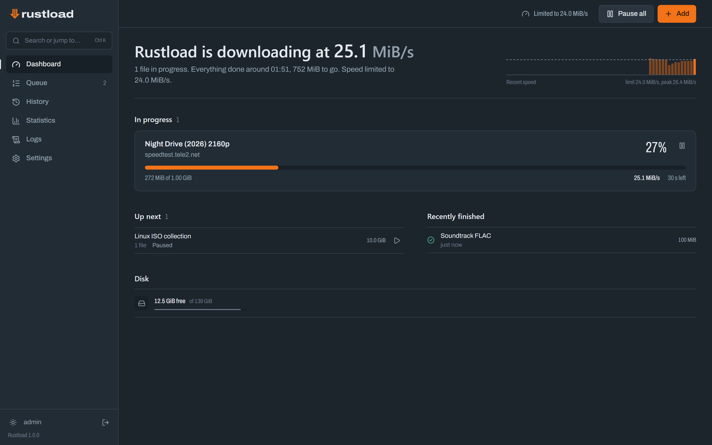
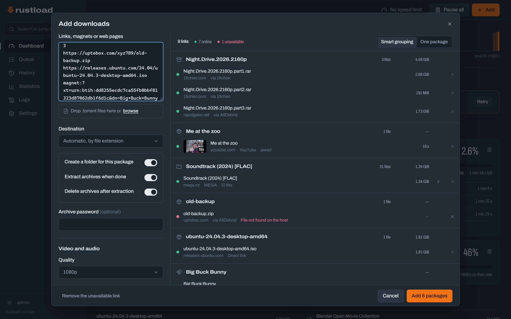
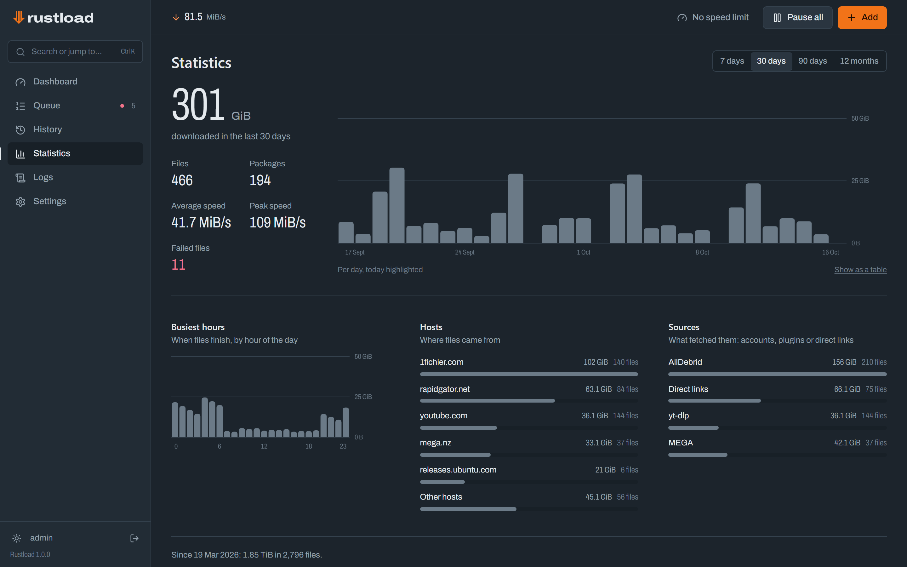
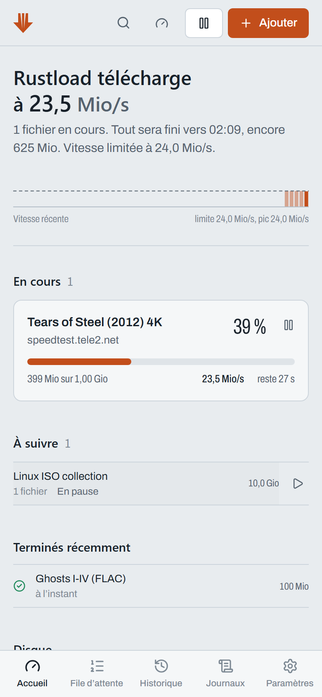

<h1 align="center">
  <picture>
    <source media="(prefers-color-scheme: dark)" srcset="docs/brand/rustload-lockup-dark.svg">
    
  </picture>
</h1>

<p align="center">
  The download manager for your server. Paste anything, Rustload checks it, sorts it and pulls it in
  at full speed.<br>
  One small binary, one Docker image, a desktop app and a web interface that works on your phone.
</p>

<p align="center">
  <a href="https://github.com/rustload/rustload/releases/latest"></a>
  <a href="https://github.com/rustload/rustload/stargazers"></a>
  <a href="https://github.com/rustload/rustload/actions/workflows/ci.yml"></a>
  <a href="https://github.com/rustload/rustload/pkgs/container/rustload"></a>
  <a href="LICENSE"></a>
</p>

<p align="center">
  <a href="README.fr.md">Version française</a> ·
  <a href="docs/configuration.md">Configuration</a> ·
  <a href="docs/API.md">API</a> ·
  <a href="docs/architecture.md">Architecture</a> ·
  <a href="extension/README.md">Browser extension</a>
</p>



## What it does

**Grab anything.** Paste links, magnets or a whole web page — or drop `.torrent` files. The link
grabber checks every link before anything starts: name, size, availability, which account will
download it, and whether you already have it. Multi-part archives, folders and playlists become
their own packages. Web pages are scanned for downloadable links on request.

**Download fast.** Every file is split across several connections that steal work from each other,
adapt to servers that limit connections and resume exactly where they stopped. The queue shows it
happening: a map of each file, with a bright tick where every connection is writing.

**Debrid and premium accounts.** AllDebrid, Real-Debrid, Premiumize.me, Debrid-Link and TorBox for
hundreds of hosts, magnets and torrents; premium accounts on 1fichier, Rapidgator and Keep2Share
(FileBoom, Tezfiles) through their official APIs. Accounts are tried in your order and Rustload
falls back to the next one when a quota runs out.

**Video and audio sites.** YouTube, Vimeo, Twitch, SoundCloud, X, Instagram, TikTok and about
twenty other sites through yt-dlp, plus any page yt-dlp supports once *Try yt-dlp on other web
pages* is on: pick a quality or audio only, grab whole playlists, subtitles, SponsorBlock. HLS
streams (`.m3u8`) become one video file and M3U lists their links. yt-dlp updates itself; ffmpeg
ships in the Docker image.

**Files you can trust.** Automatic extraction (RAR, 7z, ZIP, tar, multi-volume, password lists),
checksum verification (SFV, MD5, SHA) with a "verified" mark, categories that pick their folder by
rule or file extension (mounted volumes welcome), and clean file ownership in Docker (`PUID`/`PGID`/`UMASK`).

**Runs itself.** A download window and speed rules ("slow during the day, full speed at night"), a
free-space guard, notifications (Discord, Telegram, ntfy, Gotify, webhooks, browser), scripts on
completion, statistics, diagnostics, backup and restore.

**Send links from anywhere.** The browser extension (Chrome, Edge, Brave, Firefox), a bookmarklet,
your phone's share sheet (install Rustload as an app), a Telegram bot, a watch folder, Click'n'Load
and a REST API with a key. Prometheus metrics for your Grafana.

**Pleasant to use.** Keyboard first (<kbd>Ctrl</kbd>+<kbd>K</kbd> command palette, <kbd>N</kbd> to
add, paste links anywhere), dark and light themes, English and French, built for phones too.

Rustload is written in Rust and stays small: a single ~16 MB binary with the interface built in,
about 8 MB of memory at rest and under 20 MB while downloading at 35 MiB/s over 8 connections,
SQLite for storage. It can replace pyLoad or JDownloader on a home
server; captcha solving for free hosters is not supported — use a debrid or premium account for
those.

## Screenshots

| Link grabber | Statistics | Phone |
|---|---|---|
|  |  |  |

## Quick start (Docker)

```yaml
# docker-compose.yml
services:
  rustload:
    image: ghcr.io/rustload/rustload:latest
    container_name: rustload
    restart: unless-stopped
    ports:
      - "8800:8800"
    environment:
      PUID: "1000"   # files are created as this user…
      PGID: "1000"   # …and this group (see `id` on the host)
      UMASK: "022"
      TZ: "Europe/Paris"
    volumes:
      - ./config:/config
      - /srv/downloads:/downloads
```

```sh
docker compose up -d
```

Open `http://<server>:8800`, create the administrator account and follow the setup checklist on the
dashboard. Images are published for `linux/amd64` and `linux/arm64`.
[docs/configuration.md](docs/configuration.md) covers every option: environment variables,
categories, schedule and speed rules, accounts, video sites, watch folder, Click'n'Load, Telegram
bot, Prometheus, hooks and reverse proxies.

## Desktop app

Rustload also comes as an app for Windows, macOS and Linux (AppImage, .deb), from the
[latest release](https://github.com/rustload/rustload/releases/latest): a window of its own and an
icon in the notification area that shows the speed, pauses everything and keeps going once the
window is closed. On first start it asks how you want to use it:

- **On this computer**: Rustload downloads into *Downloads › Rustload*, opens without a login and
  can start with the computer. 7-Zip and ffmpeg install in one click from the settings on Windows.
- **With your Rustload server**: the app drives the Rustload of your NAS or Docker server with its
  address and API key (*Settings › Integrations*), without opening a browser.

Either way it opens magnet links, turns finished or failed packages into system notifications and
updates itself (signed updates, installed when you are not using it). On Windows,
`Rustload_…_x64-portable.zip` runs without installing: unzip it anywhere, a USB drive included; its
`data` folder keeps everything the app writes. The installers are not signed
yet: Windows SmartScreen asks for confirmation (*More info › Run
anyway*) and macOS wants the app opened from its context menu the first time.

## Without Docker

Every [release](https://github.com/rustload/rustload/releases/latest) has a ready-to-run binary for
Linux (x86-64 and ARM64, static: any distribution), Windows (x86-64) and macOS (Apple silicon and
Intel). Extract it and start it:

```sh
./rustload        # rustload.exe on Windows
```

Rustload listens on port 8800 and keeps its settings in `./config` and its downloads in
`./downloads`, next to where it starts; `RUSTLOAD_PORT`, `RUSTLOAD_CONFIG_DIR` and
`RUSTLOAD_DOWNLOAD_DIR` change that. Rustload installs yt-dlp itself from *Settings › Video sites*;
on Windows it installs 7-Zip (RAR/7z archives) and ffmpeg (video sites) the same way, elsewhere they
come from your package manager. The macOS binary is not notarized:
allow it once with `xattr -d com.apple.quarantine rustload`.

## Building from source

Requirements: Rust 1.94+, Node.js 22.12+ with pnpm. Optional at runtime: 7-Zip (`7zz`, `7z` or `7za`)
for RAR/7z, yt-dlp and ffmpeg for video sites (Rustload can install yt-dlp itself).

```sh
cd web && pnpm install && pnpm build && cd ..   # the interface is embedded in the binary
cargo build --release
RUSTLOAD_CONFIG_DIR=./config RUSTLOAD_DOWNLOAD_DIR=./downloads ./target/release/rustload
```

To build the Docker image: `docker buildx build --platform linux/amd64,linux/arm64 -t rustload .`
See [CONTRIBUTING.md](CONTRIBUTING.md) for the development workflow.

## Roadmap

- Captcha handling (browser-assisted) for free hoster downloads
- More premium hosters with official APIs
- RSS and site watchers that add new releases automatically

## Responsible use

Rustload downloads what you ask it to, from services you have access to. Respect copyright and the
terms of the services you use: Rustload hosts no content and gives access to nothing you could not
download yourself. It is not affiliated with or endorsed by the debrid services, file hosts and
video sites it works with; their names are trademarks of their respective owners.

## License

[MIT](LICENSE). The license covers the code, not the Rustload name and logo, which are described in
the [brand guidelines](docs/brand/README.md); bundled third-party work is listed in
[THIRD-PARTY-NOTICES.md](THIRD-PARTY-NOTICES.md). Rustload is an independent project, not affiliated
with the Rust Project or the Rust Foundation. Contributors follow the
[code of conduct](CODE_OF_CONDUCT.md).
