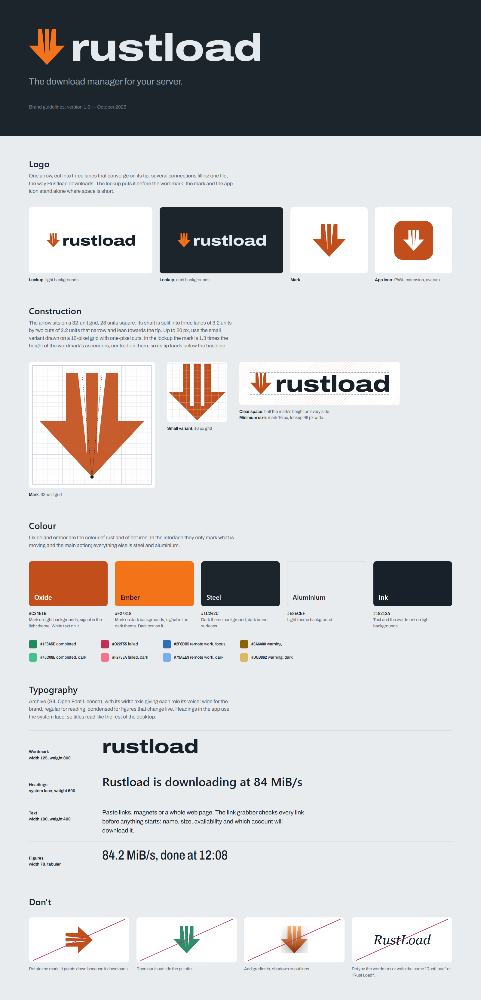

# Rustload brand guidelines

## Name

**Rustload** — "Rust" for the language it is written in and for oxidised iron, "load" for what it
does. Written as one word with a capital R in sentences ("Rustload checks every link"), never
"RustLoad", "Rust Load" or "rust-load". The wordmark itself is lowercase. In code, packages and
configuration the name is `rustload` (binary, crate, Docker image) and `RUSTLOAD_` (environment
variables).

Rustload is an independent project. It is not affiliated with or endorsed by the Rust Project or
the Rust Foundation, and the brand never uses the Rust logo.

## Logo

The mark is one arrow whose shaft is cut into three lanes converging on its tip: several
connections filling one file, the way Rustload downloads. It points down because it downloads;
it is never rotated.

| File                                                                                                             | Use                                                                                                            |
| ---------------------------------------------------------------------------------------------------------------- | -------------------------------------------------------------------------------------------------------------- |
| [`rustload-lockup.svg`](rustload-lockup.svg)                                                                     | Mark and wordmark on light backgrounds (README, website, documents)                                            |
| [`rustload-lockup-dark.svg`](rustload-lockup-dark.svg)                                                           | Mark and wordmark on dark backgrounds                                                                          |
| [`rustload-mark.svg`](rustload-mark.svg) / [`-dark`](rustload-mark-dark.svg) / [`-mono`](rustload-mark-mono.svg) | The mark alone: oxide, ember, black (recolour the mono file in white for photos and dark single-colour prints) |
| [`rustload-icon.svg`](rustload-icon.svg), [`rustload-icon.png`](rustload-icon.png)                               | App icon: white mark on an oxide tile (avatars, PWA, store listings)                                           |
| [`social-preview.png`](social-preview.png)                                                                       | 1280 × 640 card for the GitHub repository and link previews                                                    |

All files are paths only: they render the same without the font installed.

**Construction.** The arrow sits on a 32-unit grid and spans 28 units in both directions. The
shaft is 14 units wide and split into three lanes of 3.2 units by two cuts of 2.2 units that
narrow and lean towards the tip. The head is 28 units wide and 15 tall.

**Small sizes.** Up to 20 px, use the small variant drawn on a 16-pixel grid with one-pixel cuts
(`web/public/favicon.svg`, the `MARK_SMALL` path in `web/src/lib/brand.ts`). The favicon,
`favicon.ico` and the extension's toolbar icons use it.

**Lockup.** The mark is 1.3 times the height of the wordmark's ascenders and centred on them, so
its tip lands below the baseline; the gap between them is 0.3 times the ascender height. Keep a
clear space of half the mark's height around the lockup. Minimum sizes: mark 16 px, lockup 96 px
wide.

**Don't** rotate, stretch or redraw the mark, recolour it outside the palette, add gradients,
shadows or outlines, or set the name in another typeface as a logo.

## Colour

Oxide and ember are the colours of rust and of hot iron; steel and aluminium carry everything
else. In the interface, the signal colour (oxide in the light theme, ember in the dark one) only
marks what is moving and the main action of a screen.

| Name        | Hex       | Use                                                                 | Text on it        |
| ----------- | --------- | ------------------------------------------------------------------- | ----------------- |
| Oxide       | `#C24E1B` | Mark on light backgrounds, signal in the light theme, app icon tile | white (4.8:1)     |
| Oxide deep  | `#A6420F` | Signal-coloured text on light backgrounds (5.7:1 on panels)         | white             |
| Ember       | `#F27318` | Mark on dark backgrounds, signal in the dark theme                  | `#1F0F04` (6.4:1) |
| Ember light | `#FF9150` | Signal-coloured text on dark backgrounds (6.4:1 on panels)          | `#1F0F04`         |
| Steel       | `#1C242C` | Dark theme background, dark brand surfaces                          | `#E4E9ED`         |
| Aluminium   | `#E8ECEF` | Light theme background                                              | `#18212A`         |
| Ink         | `#18212A` | Text and the wordmark on light backgrounds                          | white             |

Status colours, light / dark: completed `#1F8A5B` / `#45C08E`, failed `#C22F55` / `#F2738A`,
remote work and focus `#2F6DB5` / `#79AEE9`, warning `#8A6400` / `#DCB862`. Failed is crimson
rather than red so it never reads as oxide. The full token list lives in `web/src/app.css` and
`web/DESIGN.md`.

## Typography

[Archivo](https://github.com/Omnibus-Type/Archivo) (SIL Open Font License), self-hosted: its width
axis gives each role its voice. Headings in the interface use the system face instead (Segoe UI,
San Francisco, Roboto...).

| Role                           | Width         | Weight             |
| ------------------------------ | ------------- | ------------------ |
| Wordmark                       | 125 %         | 800, tracking −1 % |
| Text                           | 100 %         | 400–500            |
| Figures (speeds, sizes, times) | 78 %, tabular | 400–500            |
| Hero readout                   | 64 %, tabular | 300–500            |

## Voice

Plain and specific, in sentence case. Say what Rustload is doing ("Rustload is downloading at
84 MiB/s"), name things by what people recognise (links, packages, accounts) rather than by how
they are built, and make errors say what happened and what to do next.
